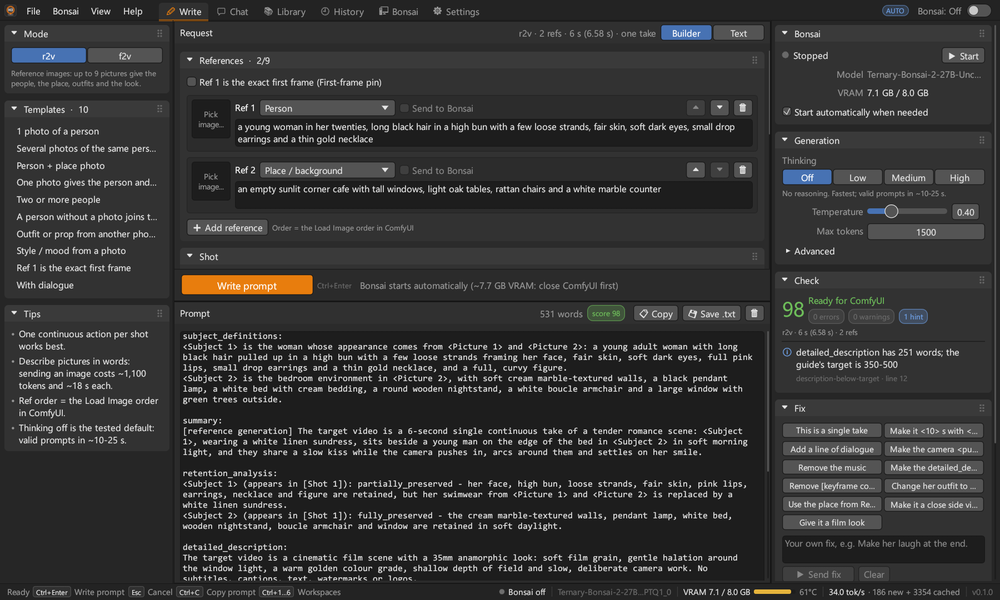

# Bonsai H3 Writer

Write **MiniMax H3** video prompts with your local **Bonsai 27B**, in a Blender-style desktop app
or from the command line.

Bonsai H3 Writer runs Bonsai's `llama-server` itself - from model files on your PC, from a download,
or from your [Bonsai-demo](https://github.com/PrismML-Eng/Bonsai-demo) install. You describe a clip in plain
words ("Ref 1: a young woman in a red coat. Place: a rainy street at night. 6 s, one take: she
turns to the camera and smiles"), and Bonsai turns that into a prompt in the official H3 format,
ready to paste into ComfyUI. The app replaces Bonsai's web UI for this job: it starts Bonsai when a
prompt is needed, checks the result, and stops Bonsai again so ComfyUI gets the GPU back.



<!-- docs/screenshot.png: refresh it with the recipe under "Build from source", with a fresh BH3_CONFIG_DIR. -->

## Contents

- [What it does](#what-it-does)
- [Workspaces](#workspaces)
- [Requirements](#requirements)
- [Install](#install)
- [First run](#first-run)
- [Run without Bonsai-demo](#run-without-bonsai-demo)
- [New PC without Bonsai-demo](#new-pc-without-bonsai-demo)
- [Quick start: write a prompt](#quick-start-write-a-prompt)
- [Why thinking is off by default](#why-thinking-is-off-by-default)
- [Bonsai and ComfyUI share the GPU](#bonsai-and-comfyui-share-the-gpu)
- [Closing the app](#closing-the-app)
- [Command line: bh3](#command-line-bh3)
- [Use it from Claude Code (MCP)](#use-it-from-claude-code-mcp)
- [Keyboard shortcuts](#keyboard-shortcuts)
- [Where your data is stored](#where-your-data-is-stored)
- [Troubleshooting](#troubleshooting)
- [Build from source](#build-from-source)
- [Official H3 prompt guides](#official-h3-prompt-guides)
- [License](#license)

## What it does

- **Writes official-format H3 prompts** for both ways of using H3:
  - **r2v** (reference-to-video): up to 9 reference pictures (`<Picture 1>` ... `<Picture 9>`)
    give the look of people, places, outfits, props or style. The prompt has the six sections
    `subject_definitions`, `summary`, `retention_analysis`, `detailed_description`,
    `overall_soundscape` and `non_diegetic_music`.
  - **f2v** (first-frame video): a first frame (I2VA) or a first and a last frame (FL2VA). The
    prompt starts with the alignment line, then `integrated_multimodal_description`,
    `overall_soundscape` and `non_diegetic_music`.
- **Describes your reference pictures once.** Pick a picture and Bonsai's vision input writes
  what it shows for its role (a person, a place, an outfit, the look) into the description, in
  about 18 s. Prompts are then written from that text: fast, cache-friendly, and you can correct
  the description. The same picture is never described twice.
- **Uses the real clip length.** H3 renders 24 fps on a 17k+5 frame grid, so a requested 6 s clip
  is really 6.58 s. Shot timestamps and the FL2VA alignment line use the real length.
- **Checks every prompt** against the guides: sections and their order, task tags, picture
  numbers, retention markers, shot timestamps, dialogue format and description length. You get a
  score, a list of issues and one-click fixes.
- **Manages Bonsai for you.** It starts Bonsai when a prompt or chat message needs it, stops it
  again after 10 idle minutes and when the app closes (if the app started it), refuses to start
  while ComfyUI holds the VRAM, and has a **Free GPU for ComfyUI** button. A power switch in the
  top bar turns Bonsai on or off at any time. It only stops the Bonsai on its own address
  (port 8080), never another program's `llama-server`.
- **Replaces Bonsai's web UI**: chat with image attachments, thinking levels, sampling settings, a
  context usage bar, the live server log and a GPU monitor, all without a browser.
- **Looks and works like Blender**: a top bar with menus, workspace tabs and the Bonsai switch; a
  toolbar on the left, editors in the middle and an N-panel of properties on the right; a dense
  dark theme; keyboard shortcuts for the main actions.
- **Has a command line tool, `bh3`**, for scripts and LLM agents such as Claude Code: no
  interactive prompts, JSON output and documented exit codes. `bh3 mcp` also serves it as an MCP
  server, so Claude Code can use it as tools.

## Workspaces

### Write

Turn a request into a prompt.

- **Left toolbar**: mode (r2v / f2v), request templates (one click fills the request), quick tips
  and the **Describe pictures automatically** switch.
- **Request** area with two tabs:
  - *Builder*: the references (role such as person, place, outfit, prop, style or first frame; a
    description; an optional image with a thumbnail and a "send to Bonsai" switch with a token
    warning; reorder and remove; up to 9 in r2v, first and last frame in f2v), the shot (duration
    with the real H3 length, cuts, action), the look (style, camera, place, outfit, people
    without a photo), dialogue lines and notes.
  - **Pictures are described for you**: pick a picture (click the slot; pick several at once to
    add a reference for each) and Bonsai looks at it once for the card's role - "Describing...
    12 s" with Cancel - and writes one paragraph into the empty description, marked *written by
    Bonsai - edit freely*, with a Re-describe button. Changing the role describes it again while
    the text is still Bonsai's. Text you typed is never overwritten: such a card has a **Describe
    with Bonsai** button, and a description that arrives after you typed is offered ("Use it")
    instead. Descriptions are saved by picture and role (`descriptions\` in the config folder),
    so the same picture is never described twice. Without a vision projector (mmproj) the card
    says so and you describe the picture in words. The Write button waits until the pictures are
    described. "Send to Bonsai" (off by default) still sends the picture itself with every prompt,
    at ~1,100 tokens and ~18 s each time.
  - *Text*: the request that is sent, editable, with "Rebuild from form" after you edit it.
- **Write prompt** (Ctrl+Enter) and **Cancel** (Esc), with the current step (starting Bonsai,
  loading the model, writing).
- **Prompt** area: Bonsai's reasoning (collapsible, when thinking is on), the prompt (monospace,
  editable, re-checked while you edit), Copy, Save .txt, word count and the check badge.
- **N-panel**: Bonsai (status, start / stop, auto-start), Generation (thinking, temperature, max
  tokens; advanced: top-p, top-k, min-p, seed), Check (score and issues), Fix (the library's
  follow-up fixes as buttons, or your own fix, sent as a follow-up), Checklist (before you render)
  and Last run (new and cached tokens, generated tokens, tokens per second, time).
- The draft is saved: the request you are working on is still there after a restart.

### Chat

Talk to Bonsai directly, as in its web UI.

- Conversations on the left (new, rename, delete), saved automatically.
- Messages with role, collapsible reasoning and copy; Enter sends, Shift+Enter adds a line;
  attach images; Stop.
- Right panel: system prompt (none, H3 r2v, H3 f2v or your own), generation settings, a context
  usage bar (prompt tokens of the context size), regenerate and clear.

### Library

The texts behind the writer, ready to edit: the r2v and f2v system prompts, the request templates,
the follow-up fixes, the checklist and short readable guides. Save (Ctrl+S), Revert, Reset to
built-in, Copy, and a token count while Bonsai runs. Edited items get a badge; your versions are
stored separately, so the built-in texts are never lost.

### History

Every written prompt is saved with its request, settings, timings and check score (unless you turn
history off in Settings). Search, filter by mode or stars, preview the request and the prompt,
Copy, **Open in Write**, Export .txt, Star and Delete.

### Bonsai

Everything about the server.

- **Install**: the Bonsai-demo folder and its detected parts (launcher, `llama-server.exe`, model,
  vision projector), with Change.
- **Launch options**: auto-start, auto-stop minutes, stop on exit, VRAM busy threshold, context
  size, vision projector on CPU, extra environment variables for the launcher.
- **Status**: state, model and its quantization type, context size, slots, vision, build, uptime
  and the auto-stop countdown, with Start, Stop, Restart, Open web UI and **Free GPU for ComfyUI**.
- **GPU**: VRAM bar, temperature, load and the processes on the GPU, with a warning when
  `python.exe` (ComfyUI) holds memory.
- **Log**: the live server log with filter, autoscroll, copy and open file.

### Settings

UI scale (also Ctrl+Plus / Ctrl+Minus), accent colour, monospace prompts, show reasoning, save
history, default clip duration, describe pictures automatically, server URL, default generation settings for prompts and for chat,
the config folder, reset and About.

## Requirements

- **Windows 10 or 11**, 64-bit.
- **Bonsai itself**, one of:
  - **model files on your PC** - a Bonsai 2 `.gguf` (and its `*mmproj*.gguf` for pictures), used
    where they are; the app downloads the matching `llama-server` build (see
    [Run without Bonsai-demo](#run-without-bonsai-demo)),
  - **a download** from the app (server build + Bonsai 2 27B, about 6.7 GB), or
  - **a working Bonsai-demo folder** ([PrismML-Eng/Bonsai-demo](https://github.com/PrismML-Eng/Bonsai-demo))
    with:
    - `scripts\start_llama_server.ps1`, the official launcher (the app starts Bonsai through it),
    - a built `llama-server.exe` in `bin\cuda\` (or `bin\hip\`, `bin\vulkan\`, `bin\cpu\`),
    - a Bonsai 27B model (`.gguf`) under `models\`, plus its `mmproj` file if you want to send
      images.

    If Bonsai starts with the demo's own scripts, it works with this app.
- The `llama-server` build needs the **Microsoft Visual C++ runtime** (2015-2022, x64). Most PCs
  have it; if not, the app says so and links to Microsoft's
  [vc_redist.x64.exe](https://aka.ms/vs/17/release/vc_redist.x64.exe).
- **An NVIDIA GPU is recommended.** Tested on an RTX 4060 Laptop GPU with 8 GB; Bonsai 27B then
  uses about 7.7 GB of VRAM. Other llama.cpp backends work, more slowly.
- Windows PowerShell 5.1 (part of Windows) runs the launcher. The GPU card uses `nvidia-smi`, which
  comes with the NVIDIA driver.
- To render the prompts: MiniMax H3 in ComfyUI. The app itself does not need ComfyUI.

## Install

1. Download `BonsaiH3Writer-<version>-windows-x64.zip` from the
   [latest release](../../releases/latest).
2. Optional: check the download. The hash must match the one in the `.zip.sha256` file next to it:

   ```powershell
   (Get-FileHash .\BonsaiH3Writer-<version>-windows-x64.zip -Algorithm SHA256).Hash
   ```

3. Extract the zip anywhere, for example to `C:\Tools\BonsaiH3Writer`. There is no installer and
   no admin rights are needed.
4. Start `bonsai-h3-writer.exe`. The executables are not code-signed, so Windows SmartScreen may
   say "Windows protected your PC": click **More info**, then **Run anyway**.

The zip contains:

| File | What |
|---|---|
| `bonsai-h3-writer.exe` | the desktop app |
| `bh3.exe` | the command line tool |
| `README.md`, `CHANGELOG.md`, `LICENSE` | this file, the version history, the MIT license |
| `docs\CLI.md` | the full command line reference |
| `docs\AGENT_GUIDE.md` | the guide for LLM agents (also `bh3 agent-guide`) |
| `docs\MCP.md` | how to connect `bh3 mcp` to Claude Code and other MCP clients |

## First run

The **Setup** dialog opens on the first start. It offers three ways:

- **Model files on this PC** - pick your `.gguf`; it stays where it is (see
  [New PC without Bonsai-demo](#new-pc-without-bonsai-demo)).
- **Download Bonsai** - the server build for your GPU plus Bonsai 2 27B PTQ1_0 and its vision
  projector (about 6.7 GB), with the total size and the free disk space shown first.
- **Bonsai-demo folder** - as before:

1. It lists the Bonsai installs it finds (for example `D:\Bonsai-demo`, `C:\Bonsai-demo`,
   `%USERPROFILE%\Bonsai-demo`, `%USERPROFILE%\Documents\Bonsai-demo` or a `Bonsai-demo` folder
   beside the app's folder). Pick one, or click
   **Browse...** and choose your Bonsai-demo folder (the one with `start_bonsai.bat`, `scripts\`,
   `bin\` and `models\`).
2. The validation list shows what was found: launcher, `llama-server.exe`, model and vision
   projector.
3. Click **Use this folder**.

That's all. From now on the app starts and stops Bonsai itself. To use another folder later, open
the **Bonsai** workspace and click **Change** under Install. **Import into the app** (on the same
page) copies the folder's `llama-server`, model and projector into the app's own folder (or moves
them, with "Move instead of copy") - optional: using the folder needs no copy.

## Run without Bonsai-demo

The app can run Bonsai on its own: it starts PrismML's `llama-server.exe` directly with the flags
the demo's `start_llama_server.ps1` passes for a Bonsai 2 model (`--jinja`, the model card's
sampling, `-ngl`, `-fa on`, context, `--mmproj`, the image-token cap, the 4-bit KV cache when
chosen). Where the files come from is up to you, and they can be mixed:

| Piece | From |
|---|---|
| Model (`.gguf`) | any file on your PC, used **in place** (nothing is copied) - or downloaded from Hugging Face (the catalog, or any `owner/repo` + file) - or imported from a Bonsai-demo folder |
| Vision projector (`*mmproj*.gguf`) | found next to the model, picked by hand, or downloaded with the model; without it image input is off |
| Server (`llama-server.exe`) | downloaded by the app (PrismML's llama.cpp release `prism-b10787-73bfe6c`), any `llama-server.exe` of PrismML's fork on your PC, or a Bonsai-demo folder's `bin\cuda` |

The Bonsai 2 formats (PTQ1_0, PQ2_0) only load in **PrismML's llama.cpp fork**, not in stock
llama.cpp. The app picks the build like the demo's `setup.ps1`: NVIDIA driver with CUDA 13.3 or
newer (as `nvidia-smi` reports it) -> the CUDA 13.3 build (~545 MB with the CUDA runtime), 12.4 or
newer -> CUDA 12.4, no NVIDIA driver -> Vulkan when `vulkaninfo` is on PATH, else CPU (slow). You can
choose another one.

Downloads go to `%LOCALAPPDATA%\BonsaiH3Writer\runtime\` (`bin\<release>-<backend>\` for server
builds, `models\<owner>--<repo>\` for models); Settings > Bonsai server > **Models folder** puts the
models elsewhere, e.g. on another drive. Downloads resume: a cancelled or broken download keeps its
`.part` file and continues where it stopped. Every file is checked against its sha256 before it is
used. A gated or private repo needs a Hugging Face token (Settings > Bonsai server, or `HF_TOKEN`).

All of this is in **Bonsai > Models** (the tab next to Log): what Bonsai starts from, the downloads
with speed and time left (Cancel / Resume), the server build for this PC, the models on this PC
(**Set active** - applies on the next start, **Restart now** offered - and **Delete**, which asks
first and only ever deletes files in the app's models folder), the catalog (27B PTQ1_0, 27B PQ2_0,
9B, 4B, 2B) and a form for any Hugging Face model. Settings > Bonsai server holds the paths and the
launch options (GPU layers, image tokens, 4-bit KV cache, extra arguments).

From the command line: `bh3 models list | download | import | use | remove` and
`bh3 runtime show | download` (see [docs/CLI.md](docs/CLI.md#models)).

## New PC without Bonsai-demo

You have `Ternary-Bonsai-2-27B-Uncensored-Heretic-PTQ1_0.gguf` and
`Ternary-Bonsai-2-27B-mmproj-Q8_0.gguf` in some folder, and nothing else:

1. Start `bonsai-h3-writer.exe`. The Setup dialog opens on **Model files on this PC**.
2. Click **Browse...** and pick the model `.gguf`. A `*mmproj*.gguf` in the same folder is found by
   itself (else pick it with the second **Browse...**; without one, image input is off).
3. **Server: Not installed** - click **Download server build (CUDA 13.3, 544 MB incl. CUDA
   runtime)**. The build is picked from `nvidia-smi`; without an NVIDIA driver the dialog says so
   and offers Vulkan / CPU. A progress bar shows the speed and the time left; Cancel keeps what was
   downloaded.
4. When it is done, **Use this model** is enabled: click it. The config now holds the model and
   projector paths (where they are) and the downloaded server.
5. Write a prompt: Bonsai starts by itself.

If Windows lacks the Visual C++ runtime the server needs (`VCRUNTIME140.dll`, `MSVCP140.dll`,
`VCOMP140.DLL`), the dialog and the Bonsai workspace say so before a start and link to
[vc_redist.x64.exe](https://aka.ms/vs/17/release/vc_redist.x64.exe).

The same from the command line:

```powershell
bh3 models use "E:\Models\Ternary-Bonsai-2-27B-Uncensored-Heretic-PTQ1_0.gguf"   # projector found next to it
bh3 runtime download                                                            # the build for this GPU
bh3 status                                                                      # says what is still missing
bh3 write --mode r2v --request "..."                                            # starts Bonsai when needed
```

## Quick start: write a prompt

1. If ComfyUI is running, close it: Bonsai needs the GPU. The app warns you when it is still
   holding VRAM.
2. Open the **Write** workspace and choose **r2v** or **f2v** in the left toolbar.
3. Describe the clip in the **Builder**: a role and a picture (Bonsai describes it) or a short
   description for each reference, the duration, the action, the look. Or click a template on the left and fill in the
   `< >` parts in the **Text** tab.
4. Click **Write prompt** or press **Ctrl+Enter**. If Bonsai is off, the app starts it and waits
   for the model to load; the status bar shows the progress. With thinking off, the prompt is
   written in about 10-25 s.
5. Look at the check badge and the **Check** panel. If something is wrong, click a **Fix** (for
   example "Make the detailed_description longer") or type your own. Fixes are sent as follow-ups
   and cost only a few hundred tokens, because Bonsai keeps the system prompt cached.
6. **Copy** (Ctrl+C) and paste the prompt into H3 in ComfyUI. The **Checklist** panel lists the
   ComfyUI settings to check before you render (duration, size, reference order).
7. Done? Bonsai stops by itself after 10 idle minutes. To free the GPU right away, use the power
   switch in the top bar or **Free GPU for ComfyUI** in the Bonsai workspace.

Tips:

- **Pick a picture: Bonsai describes it once** (~18 s) and the prompt is written from that text -
  edit the description if something is wrong. Sending the picture itself with every prompt costs
  about 1,100 tokens and 18 s each time on an 8 GB laptop, and a good description works just as
  well. The picture order in the request must match the order of the reference images in ComfyUI.
- **Real lengths** used in the prompts:

  | Requested | 3 s | 4 s | 5 s | 6 s | 8 s | 10 s | 15 s |
  |---|---|---|---|---|---|---|---|
  | H3 renders | 3.04 s | 4.46 s | 5.17 s | 6.58 s | 8.00 s | 10.13 s | 15.08 s |

- If an answer goes badly wrong, write it again instead of piling up fixes: long conversations
  fill Bonsai's context.

## Why thinking is off by default

Bonsai 27B is a reasoning model, but for this job the app switches thinking **off**
(`enable_thinking: false`) and uses **temperature 0.4**. That was measured, not guessed, on an
RTX 4060 Laptop GPU (8 GB):

- With thinking on (`low` and `xhigh`), Bonsai spent 1,000-3,000 tokens reasoning without
  writing the prompt.
- With thinking off and temperature 0.4, every test run gave a valid prompt in 10-25 s.

The system prompts already contain the rules and worked examples, so Bonsai does not need to
reason its way to the format. You can still choose per job in the **Generation** panel:

| Thinking | Sent to Bonsai | Use it for |
|---|---|---|
| **Off** (default) | `enable_thinking: false` | prompt writing: fastest and most reliable |
| Low | `reasoning_effort: "low"` | some reasoning; can still use thousands of tokens |
| Medium | `reasoning_effort: "medium"` | more reasoning, slower |
| High | `reasoning_effort: "xhigh"` | full reasoning; slowest, may hit the token limit |

Reasoning and answer share the **Max tokens** budget, so raise it when you turn thinking on.
Default settings for prompts: temperature 0.4, top-p 0.95, top-k 20, min-p 0.05, max tokens 1500.
For chat: temperature 0.7 and max tokens 2048. Both can be changed in **Settings**.

## Bonsai and ComfyUI share the GPU

On an 8 GB GPU, Bonsai 27B (about 7.7 GB) and ComfyUI cannot run at the same time, so the app
hands the GPU back and forth:

- **Auto-start** (on by default): Write prompt and chat messages start Bonsai when it is not
  running. The start is refused while other programs use more than 1,500 MB of VRAM (the **VRAM
  busy threshold**; 0 turns the check off), and the message names them, for example
  "python.exe (ComfyUI?) uses 6.1 GB".
- **Auto-stop** after 10 idle minutes (0 = never) and **stop on exit**: these only apply to a
  Bonsai that the app started, and they end only that launcher and its server. Auto-stop also
  waits while another client (Bonsai's web UI, `bh3`, a script) is still getting an answer.
- A Bonsai you started yourself (for example with `start_bonsai.bat`) is simply used and never
  stopped automatically. **Stop** and **Free GPU for ComfyUI** stop it anyway: they end the
  `llama-server` on the app's server address (port 8080). A `llama-server` that another program
  runs on another port is never touched.
- Launch options are passed to the launcher as environment variables: context size as
  `BONSAI_CTX`, "vision projector on CPU" as `BONSAI_MMPROJ_CPU=1` (frees about 0.9 GB of VRAM,
  images are encoded more slowly), plus any extra variables you add, such as `BONSAI_KV4=1`.

## Closing the app

- If a prompt, a fix or a chat answer is still being written, or the **Library** has unsaved
  edits, closing the window asks first instead of throwing that work away.
- The **Write** draft is kept and comes back on the next start.
- A Bonsai that the app started is stopped (**Stop on exit**, on by default); a Bonsai you started
  yourself keeps running.

## Command line: bh3

`bh3.exe` does the same work as the app, for scripts and LLM agents. It uses the Bonsai folder,
settings, library texts and history of the app, starts Bonsai when a prompt needs it, never asks
questions, prints results on stdout and progress on stderr, and gives stable JSON with `--json`.

```powershell
# Is Bonsai installed and running? (exit 0 = ready)
bh3 status

# Write an r2v prompt (the prompt on stdout, the check summary on stderr)
bh3 write --mode r2v --request "Ref 1: a young woman with short black hair in a denim jacket. Ref 2: a rainy neon street at night (place). 6 s, one take: she turns to the camera and smiles. Style: 35mm film look."

# The same from a file, as JSON, and stop Bonsai afterwards if this command started it
bh3 write --mode f2v --request-file req.txt --json --stop-after

# Fix the newest prompt: with your own words, or with what the check found
bh3 fix --last --fix "Make the detailed_description longer (about 350 words)."
bh3 fix --last --from-lint

# Check a prompt you already have
bh3 lint --file p.txt --duration 6 --refs 2

# Let Bonsai describe a reference picture once (cached), for the request's "Ref 1: ..." line
bh3 describe photo.jpg --role person
```

| Commands | What they do |
|---|---|
| `status`, `start [--wait]`, `stop`, `restart` | Bonsai server status and control (`stop` frees the GPU for ComfyUI) |
| `write`, `fix`, `lint` | write a prompt, send a follow-up fix, check any prompt |
| `describe <IMAGE> --role ROLE` | Bonsai describes a picture once (cached) for its role |
| `chat` | one message to Bonsai, optionally with an H3 system prompt or images |
| `templates`, `template <ID>`, `fixes`, `system-prompt`, `guide` | the library texts, including your edits |
| `history list \| show \| export \| delete` | the saved prompts |
| `lengths`, `tokens`, `gpu`, `logs` | real clip lengths, token counts, GPU and server log |
| `config show \| get \| set`, `install detect \| set \| show` | settings and the Bonsai folder |
| `mcp` | an MCP server on stdin/stdout for Claude Code and other agents (see below) |
| `agent-guide`, `version` | the guide for LLM agents, the version |

Exit codes:

| Code | Meaning |
|---|---|
| 0 | success |
| 1 | failure (with `lint` and `write --strict`: the prompt has check errors) |
| 2 | wrong arguments or empty / invalid input |
| 3 | Bonsai is not running and could not be started |
| 4 | Bonsai answered with an error or an empty answer |
| 130 | cancelled with Ctrl+C |

All commands, options and JSON shapes are in **[docs/CLI.md](docs/CLI.md)** and in `bh3 --help`
(`bh3 <command> --help` for one command).

To call `bh3` from any folder, add the app folder to your user `PATH` (open a new terminal
afterwards):

```powershell
$userPath = [Environment]::GetEnvironmentVariable('Path', 'User')
[Environment]::SetEnvironmentVariable('Path', "$userPath;C:\Tools\BonsaiH3Writer", 'User')
```

**For LLM agents** (Claude Code and others): tell the agent that `bh3` writes and checks MiniMax
H3 prompts with the local Bonsai and that it should run `bh3 agent-guide` first. The guide
([docs/AGENT_GUIDE.md](docs/AGENT_GUIDE.md)) gives the recommended flow (`bh3 status --json`, then
`bh3 write ... --json --stop-after`, check `lint.ok`, then `bh3 fix --last ... --json`), how to
describe the pictures, the H3 format rules in brief and the exit codes. Or connect `bh3` as an
MCP server, as described next.

## Use it from Claude Code (MCP)

`bh3 mcp` is an [MCP](https://modelcontextprotocol.io) server: Claude Code (or another MCP client)
starts it and gets tools to write, fix and check H3 prompts with your local Bonsai, using the
app's Bonsai folder, settings and library. Add it once, with the path of your `bh3.exe`:

```powershell
claude mcp add bonsai-h3 -- "C:\Tools\BonsaiH3Writer\bh3.exe" mcp
```

Then ask Claude for an H3 prompt in plain words; `claude mcp list` shows whether the server
connects. The tools, their arguments and the setup for other clients are in
**[docs/MCP.md](docs/MCP.md)**.

## Keyboard shortcuts

| Keys | Action |
|---|---|
| Ctrl+1 ... Ctrl+6 | Write, Chat, Library, History, Bonsai, Settings |
| Ctrl+PageDown / Ctrl+PageUp | next / previous workspace |
| Ctrl+Plus (or Ctrl+=) / Ctrl+Minus | zoom the interface in / out in 10 % steps, saved as the UI scale |
| Ctrl+0 | zoom back to 100 % |
| Ctrl+Enter | Write prompt (Write) / send (Chat) |
| Esc | cancel the running job |
| Ctrl+C | copy the prompt (when no text field is being edited) |
| Ctrl+S | save the library item (Library) |
| Enter / Shift+Enter | send / new line (Chat input) |

## Where your data is stored

Downloaded server builds and models: `%LOCALAPPDATA%\BonsaiH3Writer\runtime\` (models elsewhere when
Settings > Bonsai server > Models folder says so). Model files you chose on your PC stay where they
are.


Everything lives in `%APPDATA%\BonsaiH3Writer`
(`C:\Users\<you>\AppData\Roaming\BonsaiH3Writer`):

| Path | What |
|---|---|
| `config.json` | all settings: Bonsai folder, launch options, generation defaults, UI |
| `library\` | your edited versions of the built-in texts (Reset to built-in removes them) |
| `history\` | one `<id>.json` per written prompt |
| `chats\` | the saved Chat conversations |
| `descriptions\` | Bonsai's picture descriptions, one `<sha256>-<role>.json` per picture and role |
| `server.log` | Bonsai's console output when the app starts it |

Set the environment variable `BH3_CONFIG_DIR` to use another folder, for example for a portable
install on a USB drive or for tests; the app and `bh3` both use it. To start from scratch, close
the app and delete the folder.

## Troubleshooting

- **"... uses 6.1 GB" when Bonsai should start**: another program (usually ComfyUI's `python.exe`)
  holds the VRAM. Close it and try again, or change the VRAM busy threshold in **Bonsai > Launch
  options**.
- **Bonsai does not start or stays at "Loading model..."**: read the log in the **Bonsai**
  workspace or `%APPDATA%\BonsaiH3Writer\server.log`. Check that `start_bonsai.bat` in your
  Bonsai-demo folder works on its own. A slow disk can need longer than the default 300 s start
  timeout (`start_timeout_secs` in `config.json`).
- **Something else uses port 8080**: the Bonsai launcher always serves on `127.0.0.1:8080` and does
  not start when another program answers there. Stop that program.
- **The prompt has check errors**: click a Fix or write your own; for a badly wrong answer, write it
  again.
- **Chat gets slow or the context bar is full**: start a new conversation.
- **SmartScreen blocks the exe**: see [Install](#install), step 4.

## Build from source

You need [rustup](https://rustup.rs) (MSVC toolchain) and the Visual Studio Build Tools with
"Desktop development with C++" (linker and Windows SDK; the SDK's resource compiler embeds the app
icon). `rust-toolchain.toml` pins Rust 1.99.0, the version CI and releases use; rustup downloads
it by itself on the first `cargo` command in the project folder.

```powershell
git clone https://github.com/lamdanet/bonsai-h3-writer.git
cd bonsai-h3-writer
cargo build --release
```

The executables are `target\release\bonsai-h3-writer.exe` and `target\release\bh3.exe`.

The same checks as CI:

```powershell
cargo fmt --all -- --check
cargo clippy --all-targets --locked -- -D warnings
cargo test --all-targets --locked
```

- `scripts\package.ps1` builds the release zip and its `.sha256` in `dist\`
  (`powershell -NoProfile -ExecutionPolicy Bypass -File scripts\package.ps1`).
- Publishing a release on GitHub is described in [docs/RELEASING.md](docs/RELEASING.md).
- The architecture and UI conventions are in [docs/DESIGN.md](docs/DESIGN.md).
- To refresh the screenshot, the app can save a PNG of a workspace and exit. `BH3_CONFIG_DIR`
  points it at a fresh folder, so your own settings and history stay out of a public picture:

  ```powershell
  $env:BH3_CONFIG_DIR = "$env:TEMP\bh3-screenshot"
  $env:BH3_SCREENSHOT = "docs\screenshot.png"; $env:BH3_WORKSPACE = "write"; $env:BH3_SETUP = "0"
  cargo run
  Remove-Item Env:BH3_CONFIG_DIR, Env:BH3_SCREENSHOT, Env:BH3_WORKSPACE, Env:BH3_SETUP
  ```

  `BH3_WORKSPACE` picks the workspace (`write`, `chat`, ...); `BH3_SETUP=0` hides the setup
  dialog and `BH3_SETUP=1` shows it.

Project layout: `src\lib.rs` is the core library `bh3` (server control, client, writer, checker,
library, history), `src\gui\` the desktop app, `src\cli\` the command line tool and its MCP server,
`assets\library\` the built-in texts and `tests\fixtures\` sample prompts for the checker.

## Official H3 prompt guides

The system prompts and the checker follow MiniMax's official guides:

- [Video prompt writing guide - reference mode (r2v)](https://huggingface.co/MiniMaxAI/MiniMax-H3/blob/main/docs/VIDEO_PROMPT_WRITING_GUIDE_ref_en.md)
- [Video prompt writing guide - first frame and text (T2VA, I2VA, FL2VA, L2VA)](https://huggingface.co/MiniMaxAI/MiniMax-H3/blob/main/docs/VIDEO_PROMPT_WRITING_GUIDE_base_en.md)

Short summaries are built in: **Library > Guide - r2v (images)** and **Guide - f2v (first frame)**.

## License

[MIT](LICENSE) - Copyright (c) 2026 Bonsai H3 Writer contributors.

Bonsai, llama.cpp and MiniMax H3 are separate projects with their own licenses; this app only
talks to a Bonsai server that you installed yourself.
